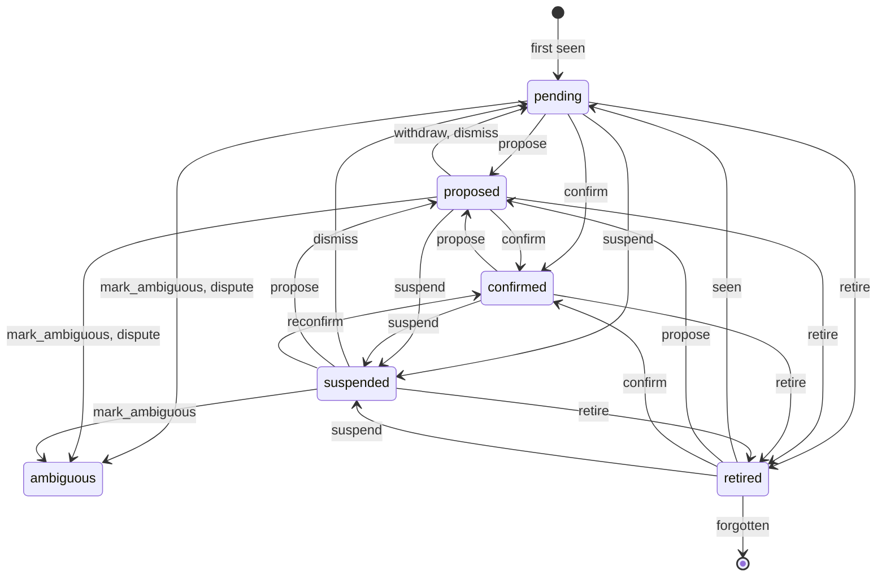
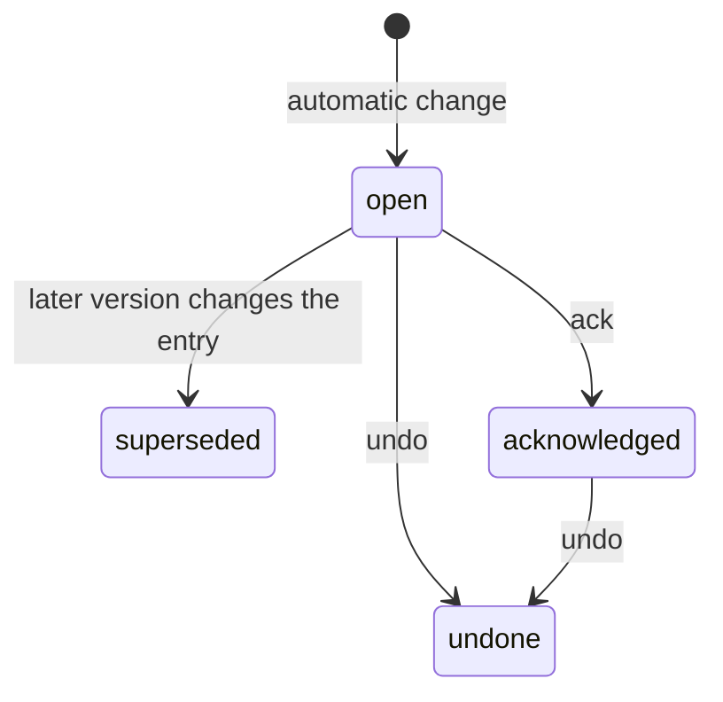

# 08 显式状态机

对象学习里有两条生命周期，过去散落在 SQL 的 `WHERE state IN (…)`、字符串比较和重复的 `match` 里。现在各有一张转移表，定义在 `crates/xshield-core/src/context/position.rs`：存储层的 SQL 守卫从表里绑定，控制面和控制台读同一组状态名。

本页两张图由转移表生成，`position.rs` 的测试 `the_documented_diagrams_are_the_ones_the_tables_draw` 保证图和代码一致。改转移表后测试会给出新的图，把它粘回这里。

## 1. 位置（`object_positions.state`）

| 事件 | 谁触发 | 写入位置 |
|---|---|---|
| `seen` | 学习任务读到一次使用 | `object_learning_store::put_evidence` |
| `propose` | 规则或学习代理给出类型 | `object_learning_store::put_judgement` |
| `confirm` / `suspend` | 学习任务复核已声明的位置 | `object_learning_store::put_judgement` |
| `withdraw` | 学习任务不再有提议 | `object_learning_store::withdraw_proposal` |
| `dismiss` | 管理员忽略 | `object_learning_store::dismiss` |
| `mark_ambiguous` | 管理员标为不确定 | `object_learning_store::mark_ambiguous` |
| `dispute` | 规则与学习代理结论不一致 | `object_agent_store::mark_disputed` |
| `reconfirm` | 管理员撤销自动变更后重新确认 | `object_learning_store::reconfirm` |
| `retire` | 超过 30 天未使用 | `object_learning_store::retire_unseen` |

不变量（各有测试）：

- `ambiguous` 不接受任何事件，只等管理员在配置里处理。
- 学习任务不能解除 `suspended`（`confirm` 不适用），只有 `reconfirm` 可以。
- `confirmed` 不能被忽略或标为不确定。
- 忽略不是状态：被忽略的位置是 `pending` 加 `dismissed` 标记，证据明显变化后 `propose` 才会再次生效（由 `put_judgement` 的 SQL 判断）。

## 2. 自动变更的处理（`object_event_status`）

`open` 和 `superseded` 不落库：没有处理记录时，配置里仍是这次变更写入的条目即 `open`，否则 `superseded`（`EventState::of`）。`ack` 和保存时的撤销都走 `EventState::handle`，被拒绝时返回 `EVENT_UNDONE` 或 `EVENT_SUPERSEDED`（409）。
